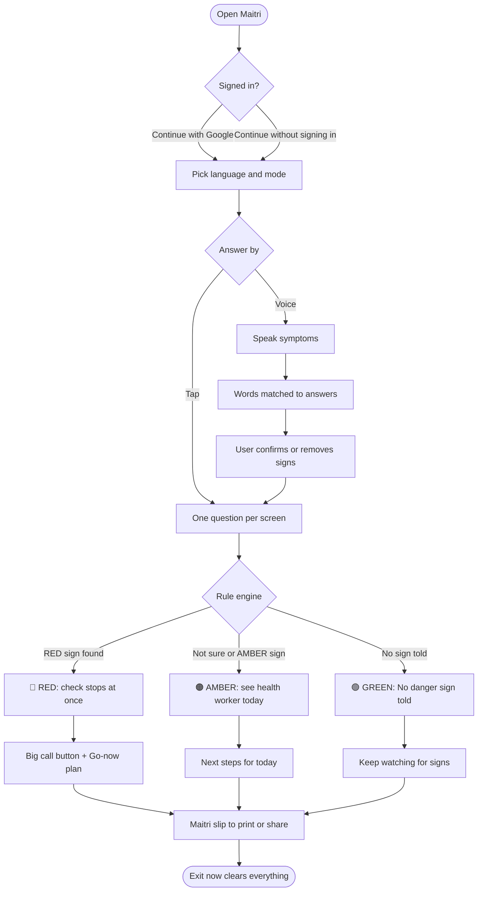
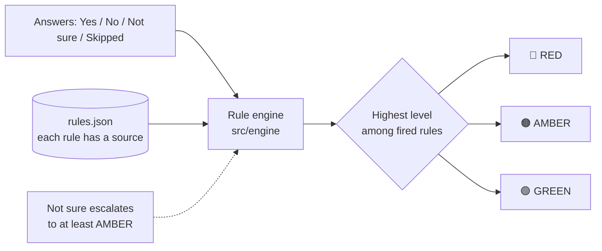
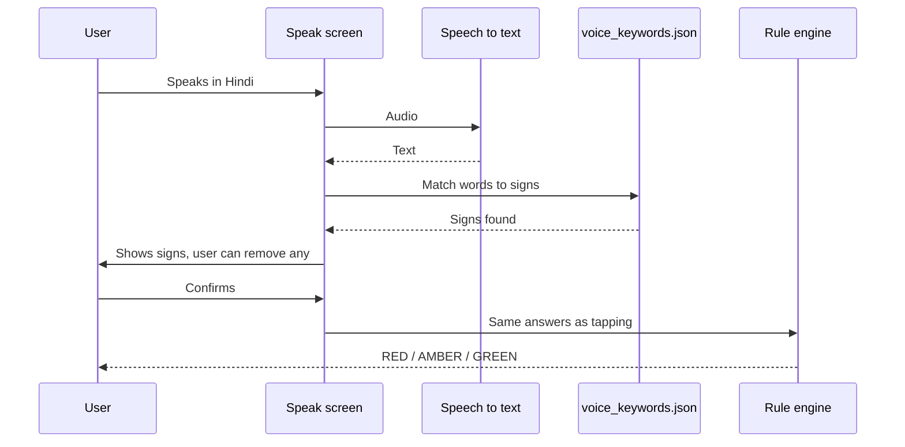
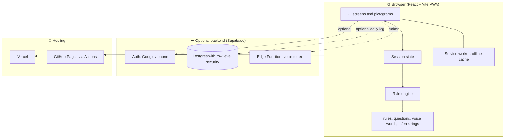

<div align="center">

# 🌸 Maitri (मैत्री)

### An offline, Hindi-first danger-sign checker for pregnant and postpartum women in India

*Tells the family what to do in the next ten minutes, and shows exactly why.*

[](https://maitri-livid.vercel.app)


**Built for recHERsion 2026 · Problem Statement 1: Women's Healthcare**

</div>

> ⚠️ **Education tool.** Maitri does not diagnose and cannot replace a health worker. The rules are a draft and have not yet been reviewed by a doctor. See [Honest Limitations](#-honest-limitations).

---

## 📌 The Problem

In India, many maternal deaths happen because danger signs are missed or recognised too late. Families, especially in rural areas, often do not know which signs mean "go to the hospital now" and which mean "see the ANM today". Connectivity is patchy, the phone is often shared, and most tools are English-first.

## 💡 Our Solution

Maitri is a simple website that asks one plain-language question at a time, in Hindi or English, by tapping or by voice, and gives one of three clear results with the reason behind it.

| Level | Shape | Meaning |
|-------|-------|---------|
| 🔴 **RED** | Octagon | Go to the hospital now |
| 🟠 **AMBER** | Triangle | See the ANM, ASHA or doctor today |
| 🟢 **GREEN** | Circle | "No danger sign told" (never "fine" or "safe") |

Every result uses **word + shape + colour together**, so a greyscale screenshot still reads correctly.

---

## ✨ Key Features

- 🗣️ **Tap or speak:** one question per screen with a picture, big Yes / No / Not sure buttons, and Listen and Slow buttons
- 🚨 **One RED sign ends the check at once** and shows a large call button
- 🧭 **Go-now plan:** call, decide who goes, show the slip, ask about free transport and care (JSSK)
- 🧾 **Maitri slip:** a one-page summary (stage, result, signs told, time, rule ids) to print or share as a picture, with no name or phone number
- 🔍 **"Why this result?":** shows the exact rule and its source, and states that no AI decides
- 🛡️ **Trust page:** rule version, source for every rule, test count, clinician review status, helpline confirmation status
- 🔒 **Private on a shared phone:** no account needed, answers stay in memory, and "Exit now" clears everything
- 📴 **Works offline** after one visit (service worker caches app, rules and fonts)
- 👥 **Three modes:** woman, ASHA/ANM, family
- 🩺 **Clinician review page** to mark rules reviewed and export an updated `rules.json`
- 🔐 **Optional login:** Continue with Google, or continue without signing in

---

## 🔄 How It Works

### User flow



### Decision logic



> The verdict is **deterministic**: no AI, no network call, no randomness. Over-escalation is accepted because missing a danger sign costs more than a false alarm.

### Voice flow



> Voice only converts speech into the same answers. It **never** decides the result.

### System architecture



> The core check works with **no backend at all**. Accounts and the daily log switch on only when Supabase keys are set.

---

## 🛠️ Tech Stack

| Layer | Technology |
|-------|------------|
| **Frontend** | React, React DOM, React Router |
| **Language** | TypeScript |
| **Build tool** | Vite |
| **Offline / PWA** | Service worker (precaches app, rules and fonts) |
| **Rule engine** | Deterministic TypeScript engine over `rules.json` |
| **Voice input** | Browser speech recognition, with a Supabase Edge Function for Bhashini speech-to-text |
| **Backend (optional)** | Supabase: Auth (Google, phone), Postgres with row level security |
| **Slip export** | html-to-image |
| **Testing** | Vitest, Testing Library, jsdom, Python reference implementation, differential testing |
| **Accessibility checks** | axe-core, Playwright, contrast checker |
| **Fonts** | Yatra One, Mukta (self-hosted via Fontsource) |
| **CI/CD and hosting** | GitHub Actions, GitHub Pages, Vercel |
| **Languages** | Hindi (default), English |

---

## 🧪 Testing and Safety

- **180+ automated tests:** all 46 rule cases, safety properties, every decision path, Hindi/English audit
- **Independent check:** a separate Python implementation of the rules must also pass 46 of 46
- **Differential testing:** 12,000+ generated answer sets re-checked against the Python version
- **Build gate:** `npm run build` runs the tests first and fails if any test fails

---

## 🚀 Run It Locally

Needs **Node 20 or newer**.

```bash
git clone https://github.com/aasthapandya04/maitri.git
cd maitri
npm install
npm run dev
```

| Command | What it does |
|---------|--------------|
| `npm test` | Runs all tests |
| `npm run build` | Tests, then production build and service worker |
| `npm run preview` | Serves the production build |
| `python3 tests/reference_check.py` | Python reference check (46 of 46) |
| `npm run test:differential` | Differential test against Python |
| `npm run check:contrast` | Colour contrast check |
| `npm run check:backend` | Verifies a configured Supabase project |

### Optional backend setup

Copy `.env.example` to `.env.local` and set `VITE_SUPABASE_URL` and `VITE_SUPABASE_ANON_KEY`. With them unset, the app shows no account features and makes no backend request. See `docs/BACKEND_SETUP.md` and `docs/DATABASE_EXPLAINED.md`.

> Never put the Supabase service role key in this repository.

---

## 📁 Project Structure

```
maitri/
├── src/
│   ├── engine/    # rule engine, types, data loader, tests
│   ├── data/      # rules.json, questions, config, voice words, hi/en strings
│   ├── lib/       # i18n, speech, audio, slip image, backend client
│   ├── state/     # session reducer, result hook, auth
│   └── ui/        # screens, components, pictograms, styles
├── supabase/      # database schema
├── tests/         # 46 rule cases + Python reference check
├── scripts/       # test report, service worker writer, contrast check
├── docs/          # spec, pitch, demo video, clinician review packet
└── public/
```

---

## 🎬 Demo

- 🌐 **Live app:** https://maitri-livid.vercel.app
- 🎥 **Demo video (about 30 sec):** [`docs/demo/maitri-demo.mp4`](docs/demo/maitri-demo.mp4)
- 📊 **Presentation:** `docs/Maitri-recHERsion-2026-final.pptx`
- 📝 **Pitch and full explanation:** `docs/PITCH_AND_EXPLANATION.md`


### 2-minute judge tour

1. Open the app. The emergency call button is the first thing on screen.
2. Pick Hindi or English.
3. Tap **Speak instead of tapping** and say the baby is born and there is heavy bleeding. Or choose *family → I had my baby* and answer Yes to heavy bleeding.
4. One RED sign ends the check: large call button, go-now plan and slip.
5. Tap **Why this result?** to see the rule and its source.
6. Answer **Not sure** on any question: the result goes up to AMBER, never GREEN.

---

## ⚠️ Honest Limitations

We would rather be clear about what Maitri is not:

- Rules are a **draft, not yet reviewed by a clinician**. `docs/CLINICAL_SIGN_OFF.md` is the empty record.
- Helpline numbers other than Tele-MANAS 14416 are not yet confirmed. The Trust page says so.
- Voice has been tested with a simulated recogniser, not yet on real phones in noisy rooms.
- Browsers cannot dial a call without a tap, so the call link is the largest control on screen.
- No field test with real users yet. The tests show the code matches the rule table; they are not clinical validation.

## 🔭 What's Next

- Clinician review and sign-off of all rules
- Real-phone voice testing in Hindi
- Confirmed state-wise helpline numbers
- Field pilot with ASHA and ANM workers

---

## 📚 Sources

MoHFW Mother and Child Protection card · HBNC leaflet · WHO *Pregnancy, childbirth, postpartum and newborn care: a guide for essential practice* · JSSK guidelines · PIB note for Tele-MANAS 14416

## 👩‍💻 Team

**Team:** *(add your team name)*
- *Name 1* – role
- *Name 2* – role

## 🙏 Credits

React, Vite, Vitest, TypeScript, Supabase, html-to-image, Playwright, axe-core. Fonts: Yatra One and Mukta (SIL OFL 1.1). Pictograms and the Maitri mark were drawn for this project as inline SVG. Built with the help of Claude Code, and the team reviews and is responsible for all content.

---

<div align="center">

**Made with ❤️ for mothers and families across India**

</div>
